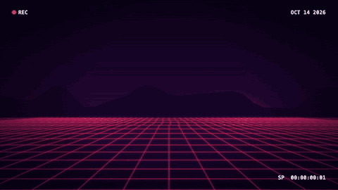

### Hi, I'm Jacopo 👋

Software Engineer and Video Designer based in Berlin. I build tools for [Claude Code](https://claude.com/claude-code), 3D things in Blender and three.js, and live visuals in TouchDesigner.

[Website](https://www.jacopocastellano.com) · [AI Digest](https://www.jacopocastellano.com/ai-digest) · [Bamboo Flags](https://bambooflags.com)

---

#### Featured

<table>
  <tr>
    <td width="50%" valign="top">
      
      <h4><a href="https://github.com/JCPetrelli/brickwise">Brickwise</a></h4>
      A Claude Code skill that explains a codebase or any complex topic as an interactive 3D brick model. Brick size shows complexity. <a href="https://jcpetrelli.github.io/brickwise/examples/">Live demos</a>.
    </td>
    <td width="50%" valign="top">
      
      <h4><a href="https://github.com/JCPetrelli/loci-forge">loci-forge</a></h4>
      Memory palaces (method of loci) that you walk in 3D, built with Blender, the Blender MCP server and Claude.
    </td>
  </tr>
  <tr>
    <td width="50%" valign="top">
      
      <h4><a href="https://github.com/JCPetrelli/TabChroma">TabChroma</a></h4>
      An iTerm2 plugin for Claude Code. The tab colour, badge and title show what Claude is doing: working, done, needs attention or waiting for approval.
    </td>
    <td width="50%" valign="top">
      
      <h4><a href="https://github.com/JCPetrelli/tab-tag">tab-tag</a></h4>
      A Claude Code mod that gives each session's iTerm2 tab its own colour and a one- or two-word name, so you can tell open sessions apart.
    </td>
  </tr>
</table>

#### More projects

| Project | What it does |
|---|---|
| [audio-filter](https://github.com/JCPetrelli/audio-filter) | Real-time voice changer for macOS. Routes the mic through Python effects into Teams, Zoom or QuickTime. |
| [amazon-order-reporter](https://github.com/JCPetrelli/amazon-order-reporter) | Chrome extension that exports amazon.de order history as a per-item CSV. |
| [powderpaint](https://github.com/JCPetrelli/powderpaint) | Flask framework that turns Markdown files into slideshows, with 7 layouts and video support. |
| [the_whisperer](https://github.com/JCPetrelli/the_whisperer) | Wrapper for Whisper to transcribe and translate videos. |
| [prompt_manager](https://github.com/JCPetrelli/prompt_manager) | CLI to manage multiple prompts for ChatGPT and other LLMs. |

#### Tools I use

Python · JavaScript · Flask · three.js · Blender · TouchDesigner · p5.js · ffmpeg · Claude Code
